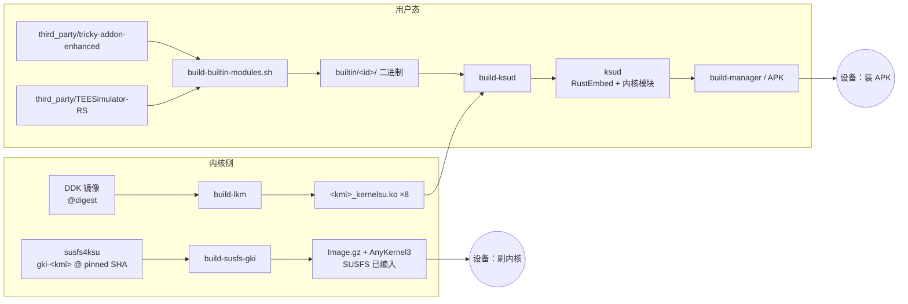
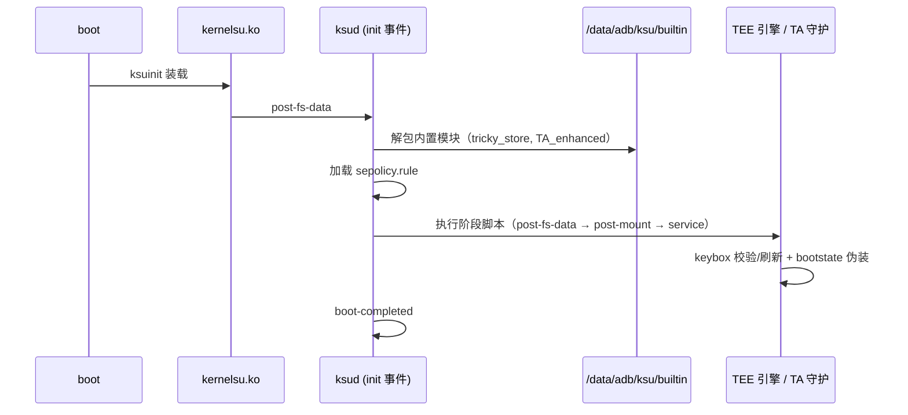
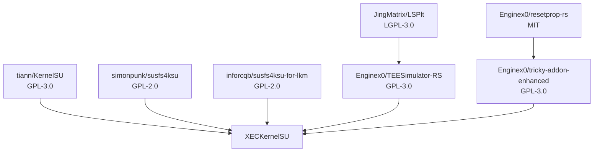

<div align="center">

# XECKernelSU

**一次刷入，四件事同时成立：可信密钥 · 回锁欺骗 · SUSFS · 检测对抗。**

[](LICENSE)
[](https://github.com/tiann/KernelSU)
[](#-susfs-两条路线)
[](#-支持的-kmi)
[](docs/STATUS.md)

[文档](#-文档导航) · [上游声明](docs/UPSTREAMS.md) · [架构](docs/ARCHITECTURE.md) · [进度](docs/STATUS.md) · [路线](docs/ROADMAP.md) · [红线](docs/RED-LINES.md)

</div>

---

## ✦ 这是什么

`XECKernelSU` 是 [KernelSU](https://github.com/tiann/KernelSU) 的一个分支。它不改变 KernelSU 的骨架，
而是在骨架之上把"刷完机就该有的四件事"做成**开箱即用**：

| | 能力 | 交付形式 |
|:--:|---|---|
| 🔑 | **可信密钥**——内置 TEE/密钥证明模拟引擎，keybox 构建时刷新、开机自校验 | 编译进 `ksud`，首启落 `/data/adb/ksu/builtin/` |
| 🔒 | **回锁欺骗**——`verifiedbootstate=green`、`flash.locked=1`、`vbmeta=locked` 三键一致 | 内置模块的 `post-fs-data` / `post-mount` 脚本 |
| 🥷 | **SUSFS**——内核级路径/挂载/属性隐藏 | **编进内核镜像**（非外挂模块）|
| 🛡 | **检测对抗**——春秋检查覆盖、keystore2 语义对齐、时序/缓存去指纹 | 引擎侧补丁 + SUSFS 隐藏面 |

> [!IMPORTANT]
> "一次刷入"是硬约束：装管理器 APK + 刷对应 KMI 的内核包，之后不需要再装任何模块。
> 详见 [docs/RED-LINES.md](docs/RED-LINES.md) 第 3 条。

---

## ✦ 交付链路



<details>
<summary><b>设备开机后发生了什么</b>（点开）</summary>



</details>

---

## ✦ 支持的 KMI

| KMI | 内核内置 SUSFS | `kernelsu.ko`（软加载） | 备注 |
|---|:--:|:--:|---|
| `android12-5.10` | ✅ | ✅ | 主验证目标（K60E）|
| `android13-5.10` | ✅ | ✅ | |
| `android13-5.15` | ✅ | ✅ | |
| `android14-5.15` | ✅ | ✅ | |
| `android14-6.1` | ✅ | ✅ | |
| `android15-6.6` | ✅ | ✅ | |
| `android16-6.12` | ✅ | ✅ | |
| `android17-6.18` | ⏳ 上游无分支 | ✅ | 暂以可加载模块兜底 |

> [!NOTE]
> SUSFS 主路线是**编进内核镜像**。`android17-6.18` 上游 `susfs4ksu` 还没有 `gki-android17-6.18`
> 分支，因此该 KMI 先走 `susfs_guard_lkm.ko`（同样由本仓编译、可加载、无模块列表条目）。

---

## ✦ SUSFS 两条路线

| | **GKI 内置（主）** | **LKM 兜底** |
|---|---|---|
| 工作流 | `build-susfs-gki.yml` | `build-susfs-lkm.yml` |
| 形态 | 编进 `Image.gz`，刷内核即生效 | 独立 `.ko`，由 ksud 落盘 / 装载 |
| 覆盖 | 7 个 KMI | 8 个 KMI（含 6.18）|
| 前置 | 能刷内核 | 无需刷内核 |
| 体积 | 随内核镜像 | 3.1–7.8 MB/KMI（**不进 APK**）|
| 用户态 | supercall 驱动 | `/proc/susfs_*` 驱动 |

两条路线**用户态语义相同**，内核 ABI 各由上游决定，不可混用。

---

## ✦ 文档导航

| 文档 | 你会看到什么 |
|---|---|
| [docs/UPSTREAMS.md](docs/UPSTREAMS.md) | 🧾 **上游声明**：每个上游的用途、pin、许可证、改动表、更新端点；明确不使用的上游 |
| [docs/ARCHITECTURE.md](docs/ARCHITECTURE.md) | 🏗 各目录职责与边界、交付/运行链路、7 条不可随意改的契约 |
| [docs/STATUS.md](docs/STATUS.md) | 📊 四个目标 × 状态 × **可复核证据**；进行中 / 未完成 / 技术债 / 风险 |
| [docs/ROADMAP.md](docs/ROADMAP.md) | 🧭 近/中/远期方向，以及**明确不做**的四件事 |
| [docs/RED-LINES.md](docs/RED-LINES.md) | 🚫 12 条开发红线，每条带"为什么"和"怎么判" |
| [docs/QUALITY-GATES.md](docs/QUALITY-GATES.md) | ✅ 门禁与预算棘轮规则 |
| [AGENTS.md](AGENTS.md) | 🤖 自动化代理的仓库操作约定 |

---

## ✦ 快速开始

```bash
# 1) 构建（CI 与本地同一条命令链）
just build-manager            # 或直接看 .github/workflows/build-manager.yml

# 2) 只跑门禁
python scripts/check_quality.py

# 3) 单独构建某个 KMI 的内核（带 SUSFS）
gh workflow run build-susfs-gki.yml -f kmi=android12-5.10
```

| 我想… | 看这里 |
|---|---|
| 加一个 KMI | [docs/ARCHITECTURE.md §5 关键契约](docs/ARCHITECTURE.md#5-关键契约改之前必须读) |
| 判断改动能不能合 | [docs/RED-LINES.md](docs/RED-LINES.md) |
| 知道现在能不能刷 | [docs/STATUS.md §5 已知风险](docs/STATUS.md#5-已知风险与限制发布说明必须带上) |

---

## ✦ 上游与许可



- 完整声明与固定版本：[**docs/UPSTREAMS.md**](docs/UPSTREAMS.md)
- 机器可读索引：[THIRD_PARTY_NOTICES.md](THIRD_PARTY_NOTICES.md)
- 代理约定：[AGENTS.md](AGENTS.md)

**许可证**：仓库整体 GPL-3.0（见 [LICENSE](LICENSE)）；`kernel/` 为 GPL-2.0；`third_party/` 各子树保留原始许可证。

<div align="center"><sub>本项目与 Google、小米、KernelSU 官方、SUSFS 作者均无隶属关系；商标归其各自所有者。</sub></div>
