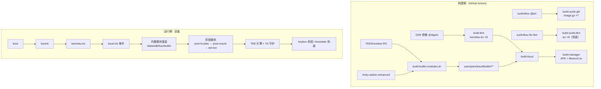
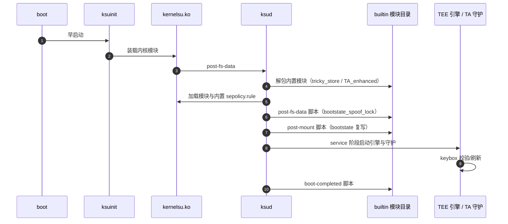

# 架构 · Architecture

**每个目录拥有什么、边界在哪、依赖谁，以及哪些契约不能随手改。**

[← 返回 README](../README.md) · [上游声明](UPSTREAMS.md) · [进度](STATUS.md) · [红线](RED-LINES.md)

---

## 1 · 全景

---

## 2 · 目录职责

| 路径 | 拥有什么 | 边界 / 不该做什么 |
|---|---|---|
| `kernel/` | KernelSU 内核模块（Kbuild）+ `CONFIG_KSU_SUSFS` 集成层 | 只写内核侧；UAPI 结构体改动必须同步三副本 |
| `userspace/ksud/` | Rust 用户态：supercall 客户端、模块管理、boot 阶段、`builtin`、`late_load`、`boot_patch` | 不直接改内核策略；特权操作走 supercall 或既有钩子 |
| `userspace/ksud/builtin/` | **内置模块源目录**（脚本/配置/NOTICE）| 禁止提交 `*.so` / `*.dex` / 可执行文件（[红线 2](RED-LINES.md)）|
| `userspace/ksuinit/` | 早启动装载器 | 不承载功能逻辑 |
| `userspace/meta-overlayfs/` | 上游元模块（OverlayFS）| 未改动 |
| `manager/` | Kotlin + Compose；`jniLibs/libxeccli.so` 就是 ksud | 不重复实现内核侧逻辑 |
| `uapi/` + 两份镜像 | supercall / ioctl / 结构体契约 | 三份必须逐字节一致 |
| `third_party/` | 三棵 vendored 上游源码树 | 只允许"上游原样 + `UPSTREAM.md` 登记的改动" |
| `feature/` | `feature/tee/`：T1/T2 验收规格与 46 例 bash 测试 | 不随产品打包 |
| `scripts/` | 质量门禁与辅助脚本 | 门禁不得被绕过 |
| `.github/workflows/` | 15 条流水线 | 上限 15，新增先删 |
| `docs/` | 本套文档 | — |

---

## 3 · 交付链路

| 工作流 | 触发 | 产物 | 说明 |
|---|---|---|---|
| `build-lkm.yml` / `ddk-lkm.yml` | push · 手动 | `<kmi>_kernelsu.ko` ×8 | 软加载路线 |
| `build-susfs-gki.yml` | 手动 | `Image.gz-<kmi>` + AnyKernel3 ×7 | **SUSFS 编进内核（主）** |
| `build-susfs-lkm.yml` | push · 手动 · 被调用 | `susfs_guard_lkm-<kmi>.ko` + 每 KMI 模块 zip | 兜底路线 |
| `ksud.yml` | 被 `build-manager` 调用 | `ksud`（3 个 Android ABI）| `pack_lkm` / `pack_ksuinit` / `pack_susfs` 控制内嵌载荷 |
| `ksud-extra.yml` | 被调用 | host 版 ksud ×5 | 桌面端 CLI |
| `ksuinit.yml` | 被调用 | `ksuinit` ×3 | |
| `build-manager.yml` | push · PR · 被调用 | **APK** | 串起 lkm / ksuinit / susfs / ksud |
| `release.yml` | 手动 · 被调用 | Release 资产 | 版本号来自 `version.properties` |
| `guards.yml` | push · PR | — | `scripts/check_quality.py`（8 道门禁）|
| `clippy.yml` / `rustfmt.yml` / `shellcheck.yml` / `clang-format.yml` | push · PR | — | clang-format 固定 **18.1.8** |
| `npm.yml` | push · PR(`js/**`) | — | 上游 JS 包测试 |

---

## 4 · 运行链路（一次开机）

> [!TIP]
> 内置模块**不走模块体系**：不出现在管理器「模块」页、不在 `/data/adb/modules/` 下、ADB 也看不到。
> 内容来自 ksud 内嵌资源，所以"装上管理器 + 刷内核"就等于装好了。

---

## 5 · 关键契约（改之前必须读）

| # | 契约 | 为什么 |
|:--:|---|---|
| 1 | **KMI 命名** `android<release>-<kernel>`（如 `android15-6.6`）| 上游 `pack_module.py` 与模块脚本按此形状解析 |
| 2 | **内核模块文件名** `{kmi}_kernelsu.ko` / `{kmi}_susfs_guard_lkm.ko` | ksud 装载器按名查表；CI 会把 `susfs_guard_lkm-{kmi}.ko` 重命名后再内嵌 |
| 3 | **内置模块布局** `builtin/<module_id>/` + 约定脚本名 | `install_builtin_modules()` 与阶段执行器按名匹配 |
| 4 | **UAPI 三副本逐字节一致** | 内核 / ksud / JNI 各读一份，不一致 = 运行时静默错位 |
| 5 | **supercall / ioctl 只允许追加** | 编号与布局是跨版本 ABI，重排即破坏兼容 |
| 6 | **`version.properties` 是版本唯一真源** | Gradle 读 `managerVersionCode` / `managerVersionName` |
| 7 | **路径常量** `/data/adb/ksu/builtin`、`/data/adb/ksu/bin`、`/proc/susfs_*` | Rust 与脚本两侧硬编码，改动需全局搜索 |

---

## 6 · SUSFS 三条路线

| | **GKI 内置（主）** | **LKM 自带（本次）** | **独立 LKM（兜底）** |
|---|---|---|---|
| 工作流 | `build-susfs-gki.yml` | `build-lkm.yml`（`susfs=true`）| `build-susfs-lkm.yml` |
| 形态 | 编进 `Image.gz`，刷内核即生效 | **编进 `kernelsu.ko`**，刷一次 LKM 就有 | 独立 `.ko`，由 ksud 落盘 / 装载 |
| 覆盖 | 7 个 KMI（现 6 绿）| 8 个 KMI | 8 个 KMI |
| 前置 | 能刷内核 | 同 LKM | APK 里要带 payload |
| 内核侧代码 | `CONFIG_KSU_SUSFS=y` → `kernel/` 集成层 | `KSU_MERGE_SUSFS_LKM=1` → `kernel/susfs/`（构建期暂存）| 不参与我们的编译 |
| 用户态 | supercall 驱动 | supercall 驱动（`/proc/susfs_*` 也在）| `/proc/susfs_*` 驱动 |

> `kernel/susfs/` 不进 git：每次构建前由 [`prepare_susfs_lkm.py`](../scripts/prepare_susfs_lkm.py)
> 从 `third_party/susfs4ksu-lkm` 现生成（kbuild 只能编 `M=` 目录内的源码），并做三件事——
> 12 个与 `kernelsu.ko` 重名的全局符号改名、接管 `module_init/exit`（一个 `.ko` 只能有一份）、
> 把 SELinux 默认域改成这棵树实际用的 `u:r:su:s0`。

> [!WARNING]
> 三条路线的**用户态语义相同，内核 ABI 不同**：GKI 用 `susfs4ksu` 的 pin；两条 LKM 都用
> `susfs4ksu-for-lkm` 的 ABI（v2.3.0 命令集）。

---

## 7 · 子系统索引

| 子系统 | 关键文件 |
|---|---|
| supercall 路由 | [`kernel/supercall/dispatch.c`](../kernel/supercall/dispatch.c)、[`supercall.c`](../kernel/supercall/supercall.c) |
| su 兼容 | [`sucompat.c`](../kernel/feature/sucompat.c)、[`setuid_hook.c`](../kernel/hook/setuid_hook.c)、[`ksud_integration.c`](../kernel/runtime/ksud_integration.c) |
| SELinux | [`selinux.c`](../kernel/selinux/selinux.c)、[`rules.c`](../kernel/selinux/rules.c)、[`selinux_hide.c`](../kernel/feature/selinux_hide.c) |
| SUSFS 链接兼容 | [`susfs_linkage.c`](../kernel/runtime/susfs_linkage.c) |
| SUSFS 合并进 LKM | [`prepare_susfs_lkm.py`](../scripts/prepare_susfs_lkm.py) |
| 内置模块（用户态）| [`assets.rs`](../userspace/ksud/src/assets.rs)、[`builtin.rs`](../userspace/ksud/src/builtin.rs)、[`init_event.rs`](../userspace/ksud/src/init_event.rs) |
| 软加载 / SUSFS 装载 | [`late_load.rs`](../userspace/ksud/src/late_load.rs) |
| 启动补丁 | [`boot_patch.rs`](../userspace/ksud/src/boot_patch.rs) |
| 特权客户端 | [`ksucalls.rs`](../userspace/ksud/src/ksucalls.rs) |
| 管理器入口 | [`MainActivity.kt`](../manager/app/src/main/java/me/weishu/kernelsu/ui/MainActivity.kt)、[`Routes.kt`](../manager/app/src/main/java/me/weishu/kernelsu/ui/navigation3/Routes.kt) |
| 验收规格 | [`feature/tee/`](../feature/tee) |
| 质量门禁 | [`check_quality.py`](../scripts/check_quality.py)、[`quality-baseline.json`](../scripts/quality-baseline.json) |
