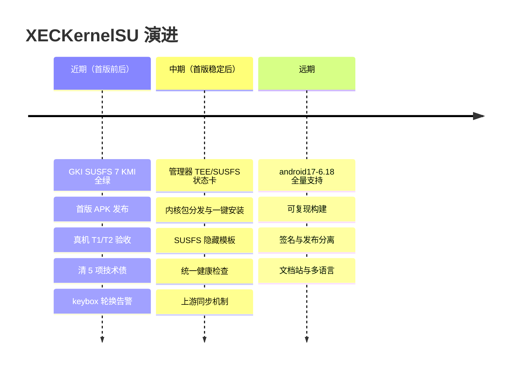

# 路线 · Roadmap

**先把"一次刷入就能用"钉死，再谈体验与生态。**

[← 返回 README](../README.md) · [上游声明](UPSTREAMS.md) · [架构](ARCHITECTURE.md) · [进度](STATUS.md) · [红线](RED-LINES.md)

---

## 时间轴

---

## 近期 · 首版发布前后

| 项 | 为什么现在做 | 完成判据 |
|---|---|---|
| **GKI SUSFS 7 KMI 全绿** | SUSFS 只有编进内核才算"刷一次就有" | 7 个 `Image.gz` + AnyKernel3 包，arm64 magic / gzip 断言通过 |
| **`ksud susfs` + 开机基线** | 内核具备 SUSFS 能力 ≠ 隐藏生效；没有用户态驱动，规则下不下去 | `ksud susfs status/version/variant/features` 可读；开机基线把关键路径/挂载/属性隐藏起来；真机 `/proc/susfs_*` 有值 |
| **首版 APK** | 用户可见的第一个产物 | `build-manager` 绿 + 产物核对（引擎、keybox 代次、`libxeccli.so`、旧图标）|
| **真机验收 T1/T2** | CI 证明不了设备行为 | [`feature/tee/test/`](../feature/tee/test) 在真机全绿；`/proc/susfs_*` 可读；bootstate 三键一致 |
| **清 5 项技术债** | 会误导用户 / 泄露凭据 / 逻辑漂移 | D1 删旧仓下载路径；D2 凭据移出代码；D3 合并或删除并行实现；D4 uapi 守卫进 `guards`；D5 保持整洁 |
| **keybox 轮换告警** | 叶子寿命约两周，到期即红 | 构建日志与管理器都能看到剩余天数与是否换代 |

---

## 中期 · 首版稳定后

| 编号 | 方向 | 要点 |
|:--:|---|---|
| M1 | **管理器 UI 补齐** | TEE 状态卡（版本 / root 类型 / 剩余天数）、SUSFS 状态卡（版本 / variant / 开关）、内核包下载与安装（按当前 KMI 自动选包，失败回滚）|
| M2 | **内核包分发** | GKI 内核按 KMI 发布到自有直链 + Release；管理器内一键下载 / 校验 / 安装；站点接入新仓 |
| M3 | **SUSFS 配置面** | `sus_path` / `sus_kstat` / `uname` / open_redirect 做成模板（"隐藏 root 痕迹"预设）；LKM 兜底复用同一套模板 |
| M4 | **可观测性** | 统一健康检查入口（keybox 链、bootstate、SUSFS、引擎存活），把 `feature/tee/*` 的诊断能力产品化 |
| M5 | **上游同步机制** | 把"跟随 `tiann/KernelSU main`"变成可重复流程：三方合并 + 冲突清单 + 门禁 |

---

## 远期

| 项 | 说明 |
|---|---|
| `android17-6.18` 全量 | 等 `susfs4ksu` 出 `gki-android17-6.18` 分支；当前用 LKM 兜底 |
| 可复现构建 | 固定工具链、记录镜像 digest、产物可复算（DDK 已按 digest 钉死）|
| 签名与发布分离 | 发布签名密钥独立于构建；提供可验证的产物清单（sha256 + 来源）|
| 文档站 | 把 `docs/` 发布成站点（当前只在仓库内）|
| 多语言 | 上游 `docs/README_*.md` 保持同步；本项目文档先中文，再按需翻译 |

---

## 不做的方向

> [!CAUTION]
> 以下四件事**明确不做**，避免范围蔓延与合规风险。要改这条清单，先改 [RED-LINES](RED-LINES.md)。

| 不做 | 原因 |
|---|---|
| 追 KPM / APatch 那套内核补丁引擎 | 与本仓 LKM + GKI 双路线冲突，收益低、维护成本高 |
| 做"通用伪装框架" | 只解决四个声明目标，不接"隐藏任何应用 / 改任何属性"的万能需求 |
| 引入 AGPL / 无许可证上游 | [红线 1](RED-LINES.md) |
| 常态化 `setenforce 0` / permissive | [红线 10](RED-LINES.md) |
