# 状态 · Status

**每一个"已完成"都带可复核的证据；没有证据的，一律放在「未验证」。**

[← 返回 README](../README.md) · [上游声明](UPSTREAMS.md) · [架构](ARCHITECTURE.md) · [路线](ROADMAP.md) · [红线](RED-LINES.md)

基准时间：2026-11-12 · 基准提交：`main` 最新

---

## 0 · 一览

| 目标 | 状态 | 一句话 |
|---|:--:|---|
| 🔑 可信密钥（TEE）| 🟢 构建成立 | 引擎与守护由源码现编进 APK；keybox 为上游最新 `Yurikey68` |
| 🔒 回锁欺骗 | 🟢 链路完整 | 内置模块 `post-fs-data`/`post-mount` 脚本已接 |
| 🥷 SUSFS | 🟢 LKM 已随 v1 发布 | **v1.0.0-xec 的 `kernelsu.ko` 自带 SUSFS**（8/8 KMI）；GKI 内置路线 6/7 KMI 绿 |
| 🛡 鸭子 / 春秋对抗 | 🟡 TEE 层已覆盖 | 引擎侧 11 个补丁已编入；隐藏面待 SUSFS 生效 |

```mermaid
gantt
  dateFormat  HH:mm
  axisFormat  %H:%M
  title 首版发布关键路径（2026-11-12 凌晨）
  section 内核（主路线）
  GKI android12-5.10 编译+修错 :active, g1, 01:22, 4h
  其余 6 个 KMI 并行           :g2, after g1, 90m
  section 用户态
  APK 构建                     :active, a1, 01:16, 2h
  产物核对                     :a2, after a1, 20m
  section 发布
  Release + 直链               :r1, after a2, 40m
```

---

## 1 · 四个产品目标

<b>🔑 可信密钥（TEE）—— 🟢 构建链成立</b>

| 证据 | 值 |
|---|---|
| 引擎编译 | `==> Building TEESimulator-RS engine (Gradle zipRelease)`→ ✅ |
| 产物字节数 | `classes.dex` 2,459,568 B · `libTEESimulator.so` 206,624 B · `libcertgen.so`（构建期内嵌）|
| TA 产物 | `ta-enhanced` 4,725,800 B · `resetprop-rs` 331,912 B |
| keybox | `DeviceID=Yurikey68`、`candidate leaf valid until Nov 13 16:32:13 2026 GMT`、`bundled keybox already up to date` |
| 落盘路径 | `/data/adb/ksu/builtin/tricky_store`（`builtin.rs::ROOT`）|

<b>🔒 回锁欺骗 —— 🟢 链路完整（待真机确认取值）</b>

| 证据 | 值 |
|---|---|
| 脚本入口 | `builtin/TA_enhanced/post-fs-data.sh` → `common/bootstate.sh::bootstate_spoof_lock` |
| 二次覆盖 | `post-mount.sh`、`prop.sh`（同一份实现）|
| 执行时机 | `init_event.rs`：post-fs-data → post-mount → service |
| 待确认 | 真机上 `ro.boot.verifiedbootstate` / `ro.boot.flash.locked` / `ro.boot.vbmeta.device_state` 三键取值 |

<b>🥷 SUSFS —— 🟡 主路线编译中 / 兜底全绿</b>

| 路线 | 状态 | 细节 |
|---|---|---|
| GKI 内置（主）| 🟢 6/7 KMI | `android12-5.10` / `13-5.10` / `13-5.15` / `14-5.15` / `14-6.1` / `15-6.6` 全绿；产物 `susfs-gki-android12-5.10` 33,362,264 B |
| GKI 缺口 | 🔴 | `android16-6.12`：内核镜像仓没有该分支历史（只在上游 GitLab），补丁 hunk 对不上 |
| LKM 自带 | 🟢 8/8 KMI | `scripts/prepare_susfs_lkm.py` 把 `third_party/susfs4ksu-lkm` 暂存进 `kernel/susfs/`，并把与 `kernelsu.ko` 重名的 12 个全局符号改名（299 处）；`KSU_MERGE_SUSFS_LKM=1` 编进**同一个** `.ko`，实测 `android12-5.10`：`kernelsu.ko` 416 KB → 1.3 MB（`llvm-strip -d` 后）|
| 用户态驱动 | 🟢 | `userspace/ksud/src/susfs.rs` 661 行、15 条 `reboot(2)` supercall、`provision_baseline()` 开机剥 `/data/adb` 等 |
| 已知缺口 | ⏳ | `android17-6.18` 上游无 GKI 分支 → 只能走 LKM |

<b>🛡 鸭子 / 春秋对抗 —— 🟡 部分覆盖</b>

| 面 | 状态 |
|---|---|
| TEE 层 | 🟢 引擎 11 个补丁（春秋覆盖、错误回包顺序、缓存失效、KeyMint 拒绝时伪造）已编入 |
| 文件/挂载隐藏 | 🟡 依赖 SUSFS 生效（SUSFS 起来即自动生效）|
| SELinux 隐藏 | 🟡 `kernel/feature/selinux_hide.c` 随 `CONFIG_KSU_SUSFS=y` 的内核镜像生效 |

---

## 2 · 基础设施

| 项 | 状态 | 证据 |
|---|:--:|---|
| 三棵上游 vendor | 🟢 | `third_party/{TEESimulator-RS,tricky-addon-enhanced,susfs4ksu-lkm}` + 各自 `UPSTREAM.md` |
| 内置模块由源码现编 | 🟢 | CI 日志 `==> Built-in module artifacts:` 全列 |
| 内置模块机制 | 🟢 | `builtin.rs` / `assets.rs` / `init_event.rs` |
| SUSFS 用户态装载器 | 🟢 | `late_load.rs`：asset → 落盘 → `insmod` → 内存兜底；`/proc/susfs_path` 已存在时直接跳过 |
| SUSFS 合并构建 | 🟢 | `scripts/prepare_susfs_lkm.py`：暂存 + 12 个符号改名（299 处）+ 接管 `module_init/exit`，生成目录 `kernel/susfs/` 不进 git |
| 质量门禁 | 🟢 | `guards` / `Clippy` / `Rustfmt` / `ShellCheck` / `ClangFormat`（18.1.8）|
| 工作流上限 | 🟢 | 15 条（恢复 GKI 时删掉 `deploy-website.yml`）|
| 文档 + 上游声明 | 🟢 | `README.md` + `docs/{UPSTREAMS,ARCHITECTURE,STATUS,ROADMAP,RED-LINES}.md` |
| 旧图标沿用 | 🟢 | `mipmap-*/ic_launcher{,_round}` 全密度 + `drawable-nodpi` 前景/开屏 + `ic_logo_vector` + 配色，`roundIcon` 已回清单 |

---

## 3 · 进行中

| 项 | 起点 | 现状 |
|---|---|---|
| **v1.0.0-xec 发布** | tag `v1.0.0-xec` @ `36d42ec1` | 🟢 已发布：APK 23,934,800 B（sha256 `e3e24401…`）+ 8 个 arm64 LKM（含 SUSFS）+ 8 个 x86_64 LKM + ksud ×8 + ksuinit ×3 |
| LKM 自带 SUSFS | `6d734d91` / `d257d782` | 🟢 8/8 KMI 编译成功（run `43089461513`）：SUSFS 编进**同一个** `kernelsu.ko`；`android12-5.10` 从 416 KB → 1.3 MB（`llvm-strip -d` 后）|
| APK 签名一致 | `36d42ec1` | 🟢 内核按 APK v2 证书识别管理器，实测下载发布包验证：**cert 1343 B (0x053f) / sha256 `8f983688…`，与 `kernel/Kbuild` 的 pin 一致** |
| APK 首版 | `904b3e1` | 21,776,030 B 已产出并核对 `libksud.so` 10,874,496 B / `classes.dex` 6,520,488 B；旧图标已换 |
| GKI 7/7 | — | 6/7 绿；`android16-6.12` 卡在内核镜像仓无该分支（见 §4 #2）|

---

## 4 · 未完成 / 技术债

| # | 项 | 说明 |
|:--:|---|---|
| **0** | ✅ `ksud susfs` 子命令 + 开机基线（`9d61702` + `36488e1`）| 661 行 `susfs.rs`、15 条 reboot supercall、`provision_baseline()` 在 post-fs-data 剥 `/data/adb`/工作目录/模块目录/daemon + sus 挂载 |
| 1 | GKI 内核 7 个 KMI 全绿 | 6/7 绿（见 §1）|
| 2 | `android17-6.18` 的 SUSFS | 上游无分支；先 LKM |
| 3 | 真机验证 | 无设备接入；T1/T2 与 `/proc/susfs_*` 未实测 |
| 4 | 管理器 TEE / SUSFS 状态卡 | 目前只有脚本/CLI 层 |
| 5 | 站点接入新仓 | 现有站点流水线只认旧仓 |
| 6 | uapi 三副本守卫 | 旧仓 `check_uapi_mirror.py` 未搬 |
| 7 | ✅ LKM 自带 SUSFS（`6d734d91` + `d257d782`）| 8/8 KMI 编译成功；`kernel/susfs/` 构建期生成、不进 git；默认开关已翻正（`susfs: true`）|

<b>已登记技术债（本轮按指示先不动）</b>

| # | 问题 | 影响 |
|:--:|---|---|
| D1 | `ExternalModulesScreen.kt` 仍从旧仓 release 下载 TEE/TA 模块 zip | 点击会拉旧仓产物 |
| D2 | `RemoteUploader.kt` 硬编码上传账号口令 | 凭据泄露（写权限、限定 `/uploads`）|
| D3 | `feature/tee/*` 与 `builtin/TA_enhanced/common/*` 逻辑重复 | 漂移风险 |
| D4 | `uapi/` 三副本无自动守卫 | 同上第 6 项 |
| D5 | — | 仓库整洁度：1413 文件 / 16.9 MB，无构建垃圾、无孤儿模块 |

---

## 5 · 已知风险与限制（发布说明必须带上）

> [!WARNING]
> **keybox 时效**：内置箱 `Yurikey68` 叶子 **2026-11-13 16:32:13 UTC** 到期。上游若未换代，
> TEE 卡会变红；运行时拉取可缓解，但设备需联网。

> [!WARNING]
> **首版无真机验证**：CI 只证明编译/打包/门禁成立，不证明设备上 TEE / bootstate / SUSFS 的实际表现。

> [!CAUTION]
> **SUSFS 时效**：GKI 路线以 `susfs4ksu` 的 per-KMI pin 为准（见 [UPSTREAMS §2.1](UPSTREAMS.md)）。
> 上游改 ABI 时必须重新钉 SHA，并与 `ksud` 的 verb 集合对齐。

| 项 | 数值 |
|---|---|
| `ksud-aarch64` 产物 | 23.9 MB（zip，含两套内置引擎 + 内核模块）|
| 发布 APK | 23,934,800 B · sha256 `e3e244011c4fc105f49e60ac71393e34677f948be3481fb517d066f64977b376` |
| 管理器签名 pin | cert `0x053f` / sha256 `8f983688359382f2e75dd72cd59398d7a0c45ed22dd1410138b34b5321a05819`（与 `kernel/Kbuild` 一致，已实测发布包） |
| 包名 / 应用名 | applicationId `www.xeckernel.pro`、应用名 `XECKernel Pro`（PR 构建 `www.xeckernel.pro.pr` / `XECKernel Pro PR`），四处同名由 `check_quality.py` 的 package identity 门禁看守 |
| SUSFS 代码 | 合并进 `kernelsu.ko`：`android12-5.10` 416 KB → 1.3 MB（`llvm-strip -d` 后，8 个 KMI 同量级）；独立 payload 实测 44.1 MB → strip 后 23.8 MB，**不进 APK** |
| 仓库体积 | 1413 文件 / 16.9 MB |
