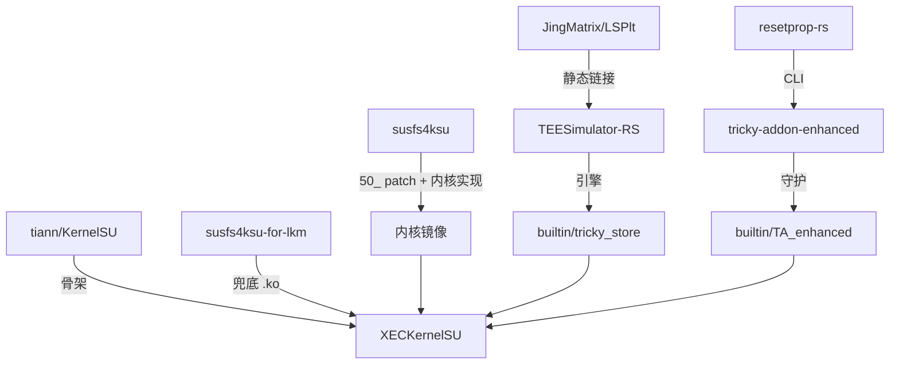

# 上游声明 · Upstream Declaration

**这个项目站在哪些肩膀上、各自固定在哪一版、我们改了什么、以及我们明确拒绝什么。**

[← 返回 README](../README.md) · [机器可读索引](../THIRD_PARTY_NOTICES.md) · [架构](ARCHITECTURE.md) · [红线](RED-LINES.md)

---

## 总览

| # | 上游 | 作用 | 固定版本 | 许可证 |
|:--:|---|---|---|---|
| 1 | [tiann/KernelSU](https://github.com/tiann/KernelSU) | 骨架：内核模块、`ksud`、管理器、UAPI | 跟随 `main` |  |
| 2 | [simonpunk/susfs4ksu](https://gitlab.com/simonpunk/susfs4ksu) | SUSFS 内核实现与 hook 点 | 每 KMI 一个提交 |  |
| 3 | [inforcqb/susfs4ksu-for-lkm](https://github.com/inforcqb/susfs4ksu-for-lkm) | SUSFS 可加载模块（兜底路线） | `f95ae4c4` |  |
| 4 | [Enginex0/TEESimulator-RS](https://github.com/Enginex0/TEESimulator-RS) | TEE / 密钥证明模拟引擎 | `v6.0.1-307` @ `6d241e56` |  |
| 5 | [Enginex0/tricky-addon-enhanced](https://github.com/Enginex0/tricky-addon-enhanced) | `ta-enhanced` 守护：keybox、bootstate | `v5.53.1` @ `5c5e4975` |  |
| 6 | [JingMatrix/LSPlt](https://github.com/JingMatrix/LSPlt) | PLT hook（随引擎编入 `.so`） | `3e29437f` |  |
| 7 | [Enginex0/resetprop-rs](https://github.com/Enginex0/resetprop-rs) | 属性读写 CLI | `4646d28a` |  |

---

## 1 · 骨架：tiann/KernelSU

> [!NOTE]
> 我们不逐提交 rebase 上游。fork 差异集中在 `third_party/`、`userspace/ksud/builtin/`、
> `kernel/` 的 SUSFS 集成层与 `.github/`，其余保持上游原样以便长期同步。

| 项 | 值 |
|---|---|
| 用途 | 工程骨架：内核模块、`ksud`、管理器、UAPI、`ksuinit` |
| 追踪 | 上游 `main` |
| 许可证 | 根 [LICENSE](../LICENSE) = GPL-3.0；`kernel/` = GPL-2.0 |
| 我们的改动 | ① `kernel/` 增加 `CONFIG_KSU_SUSFS` 集成层 ② `userspace/ksud/` 增加内置模块机制与 SUSFS 装载 ③ `manager/` 增加主题/壁纸/终端/工具箱/隐身入口 ④ 全部 CI 重写 |
| 契约 | UAPI 三副本必须逐字节一致（[ARCHITECTURE §5](ARCHITECTURE.md#5-关键契约改之前必须读)）|

---

## 2 · SUSFS 两条上游线

### 2.1 susfs4ksu —— 内核内置（主路线）

| 项 | 值 |
|---|---|
| 仓库 | <https://gitlab.com/simonpunk/susfs4ksu>（镜像 <https://github.com/ShirkNeko/susfs4ksu>）|
| 用途 | `fs/susfs.c`、`include/linux/susfs*.h`，以及 `50_add_susfs_in_gki-<KMI>.patch` 的 VFS/exec/stat/reboot/input 挂点 |
| 许可证 | GPL-2.0 |
| 我们的改动 | 不改上游；在 CI 里按 KMI 应用补丁，与本仓 `CONFIG_KSU_SUSFS=y` 的 `kernel/` 一起编译 |

<b>每 KMI 固定提交（禁止跟分支头）</b>

| KMI | 提交 |
|---|---|
| `android12-5.10` | `5436438b5cc77f146e04f71070da153dabe17a9d` |
| `android13-5.10` | `1bea9e8fb4a64920f068e5da43f9751dfe601199` |
| `android13-5.15` | `fe943d15ec6a1891f7a360bf210589bdffe4e318` |
| `android14-5.15` | `10751e3c83f6e63f886cd2af937fd0a34463824b` |
| `android14-6.1` | `69b8e734920b8f9ed885ab8d112969719698e242` |
| `android15-6.6` | `ec03d0c73b821afa1d5037d6d493216f59744fcb` |
| `android16-6.12` | `395a8c0c88d348e9fe7c14f66a456fde4653287c` |

> [!WARNING]
> 内核侧 SUSFS ABI（`SUSFS_VERSION`、`st_susfs_*` 结构体布局、`CMD_SUSFS_*` 集合）与用户态
> `ksud` 的 verb 一一对应。跟着分支头跑 = 一次静默的功能错配，甚至结构体错位。

### 2.2 susfs4ksu-for-lkm —— 可加载模块（兜底）

| 项 | 值 |
|---|---|
| 位置 | [`third_party/susfs4ksu-lkm/`](../third_party/susfs4ksu-lkm)（129 文件）|
| 固定版本 | `f95ae4c4c7df7050b2e13bc5d26403e5e0786d00` |
| 许可证 | GPL-2.0 |
| 适用 | 无法刷内核的机型；`android17-6.18`（上游无 GKI 分支）|
| 我们的改动 | 树内零改动；`.github/` 不 vendor，用本仓 `build-susfs-lkm.yml` 编译 |
| 它声明的上游 | [susfs4ksu](https://gitlab.com/simonpunk/susfs4ksu)、[SukiSU-Ultra](https://github.com/SukiSU-Ultra/SukiSU-Ultra)（`patch_memory`/`lsm_hook`/`symbol_resolver`）、[KallRecon](https://github.com/Dere3046/KallRecon) |

---

## 3 · 可信密钥链

### 3.1 TEESimulator-RS

| 项 | 值 |
|---|---|
| 位置 | [`third_party/TEESimulator-RS/`](../third_party/TEESimulator-RS)（230 文件）|
| 固定版本 | tag `v6.0.1-307`（versionCode 307）· commit `6d241e56d6e8146cd67ed4ac3dadc9c632969549` |
| 许可证 | GPL-3.0（内含 LGPL-3.0 / Apache-2.0 / GPL-2.0 子源码，见下）|
| 产物 | `classes.dex`、`libTEESimulator.so`、`libcertgen.so`、`inject`、`supervisor` |
| 更新端点 | <https://raw.githubusercontent.com/Enginex0/TEESimulator-RS/main/module/update.json> |
| 技术渊源 | [5ec1cff/TrickyStore](https://github.com/5ec1cff/TrickyStore)（GPL-3.0）|

<b>我们改了哪 11 个文件（GPL-3.0 §5(a)）</b>

| 文件 | 改动 | 原因 |
|---|---|---|
| `InterceptorUtils.kt` | 错误回包按 daemon 字段顺序重建；错误名对齐；只在 KeyMint 无能时才伪造；`unique_id` 保持拒绝 | Binder 回包错位/错误名不认识会让 `keystore2` 记录并拒绝 |
| `KeyMintSecurityLevelInterceptor.kt` | HAL 拒绝 `generateKey` 时伪造 key；回退失败保留旧 key；覆盖春秋检查；`invalidateTeeResponses()` | 探测面必须一致，且失败回退不能毁掉可用 key |
| `AuthorizeCreate.kt` | 不再过度拒绝合法操作；不再写入模板里不存在的值 | |
| `SoftwareOperation.kt` | 不再向证明链写入臆造值 | 检测方会拿链与真实 TEE 对比 |
| `AttestationBuilder.kt` | 同上（证书扩展路径）+ 春秋覆盖 | |
| `AndroidDeviceUtils.kt` | 设备属性查询去重并缓存 | 每请求重建链带来的 systime 会被时序探针看到 |
| `App.kt` | 升级时在新引擎所在的那次启动换引擎；`libcertgen.so` 从实际安装位置加载 | Android 上直接覆盖已映射 `.so` 会失败 |
| `ConfigurationManager.kt` | 配置变更时失效 TEE 响应缓存 | 否则旧配置的伪造响应会继续被复用 |
| `native-certgen/src/attestation.rs` | 春秋覆盖（native 路径）| |
| `native-certgen/src/certbuilder.rs` | 与 `AuthorizeCreate.kt` 同步的合法性修正 | |
| `gradle/wrapper/gradle-wrapper.properties` | 加大 wrapper 超时、开启重试 | runner 从 `services.gradle.org` 吃 504 |

### 3.2 tricky-addon-enhanced

| 项 | 值 |
|---|---|
| 位置 | [`third_party/tricky-addon-enhanced/`](../third_party/tricky-addon-enhanced)（`rust/` + `external/resetprop-rs/`）|
| 固定版本 | tag `v5.53.1`（versionCode 50058）· commit `5c5e49751dd844ea446c7250f09082dc61489f81` |
| 许可证 | GPL-3.0 |
| 产物 | `ta-enhanced`、`resetprop-rs` |
| 我们的改动 | 适配"内置模块"形态：内置引擎目录发现、Google RKP EC 信任锚 + SEC1 私钥 + 全链有效期、props/security-patch 变体、包枚举、region、冲突检测、状态任务 |
| 更新端点 | <https://raw.githubusercontent.com/Enginex0/tricky-addon-enhanced/main/update.json> |

<b>按区域列出的改动（摘要）</b>

清单完整版在 `third_party/tricky-addon-enhanced/UPSTREAM.md`。

- **keybox 校验**：`validate.rs`（+786 行）、`keybox/mod.rs`、`sources.rs`
- **内置引擎发现**：`health/mod.rs` —— `/data/adb/ksu/builtin/tricky_store` 优先
- **属性 / 补丁变体**：`platform/props.rs`、`security_patch/mod.rs`
- **包枚举**：新增 `platform/packages.rs`，供 watcher / applist / status 复用
- **region**：新增 `region/mod.rs`
- **冲突检测**：识别 `magisk.db`、`/data/adb/xudc`
- **守护/状态**：`daemon/{mod,scheduler,tasks}.rs`、`status/mod.rs`、`vbhash/mod.rs`
- **CLI / WebUI**：`cli/{mod,handlers,webui_init}.rs`、`config/mod.rs`
- **构建输入**：`Cargo.toml`/`Cargo.lock`（`quick-xml` / `x509-parser` / `p256` 钉版本）

### 3.3 resetprop-rs（MIT）

| 项 | 值 |
|---|---|
| 位置 | `third_party/tricky-addon-enhanced/external/resetprop-rs/`（普通文件，非 submodule）|
| 固定版本 | `4646d28a2de49c139025abc5f6d0357cd863320d` |
| 说明 | 上游 `v5.53.1` 已移除该 submodule；我们保留快照，因为内置模块仍需要独立 `resetprop-rs` |

### 3.4 LSPlt（LGPL-3.0）

| 项 | 值 |
|---|---|
| 位置 | `third_party/TEESimulator-RS/app/src/main/cpp/external/LSPlt/` |
| 固定版本 | `3e29437f037cb7d2b9fbb459dcf162f6b8d1d926`（上游在该 tag 的 submodule 指针）|
| 合规 | 完整源码与构建配方随仓提供；以普通文件提交，CI 无需 `submodules: recursive` |

### 3.5 数据与 keybox

- **keybox**：构建时由 `.github/scripts/refresh-keybox.sh` 从 [Yurii0307/yurikey](https://github.com/Yurii0307/yurikey)
  拉公开箱子（base64 源 + 明文镜像），校验结构 / 有效期 / 代次后才写入
  `userspace/ksud/builtin/tricky_store/keybox.xml`；拿不到就保留仓内副本。运行时 `TA_enhanced` 还会再拉一次。
- **target 列表**：参考 [KOWX712/Tricky-Addon-Update-Target-List](https://github.com/KOWX712/Tricky-Addon-Update-Target-List)。

---

## 4 · 随上游保留 / 由依赖系统提供

| 组件 | 来源 | 许可证 | 说明 |
|---|---|---|---|
| busybox | 上游 KernelSU（`userspace/ksud/bin/*/busybox`）| GPL-2.0 | 未修改；模块脚本与下载兜底 |
| ksuinit | 本仓 `userspace/ksuinit`（源自 KernelSU）| GPL-3.0 | 早启动装载 `kernelsu.ko` |
| DDK 内核镜像 | `ghcr.io/ylarod/ddk-min:<kmi>-20260828@sha256:…` | — | 全部按 digest 钉死 |
| Compose / Miuix / Kotlin | Gradle 依赖（不 vendor）| Apache-2.0 等 | 管理器 UI |

---

## 5 · 明确**不使用**的上游

> [!CAUTION]
> 以下三类一律不 vendor、不编译、不分发。这是历史裁决，不是临时决定。

| 类别 | 例子 | 原因 |
|---|---|---|
| AGPL-3.0 | OhMyKeymint | 许可证强度超出本项目可接受范围 |
| 无许可证 | 部分 TrickyStore 衍生工程 | 无授权即不可分发 |
| 与本仓形态无关 | 旧仓的 KPM / APatch 补丁引擎 | 与 LKM + GKI 双路线冲突，部分许可证不合规 |

> 仅作行为参考、不引入代码，是允许的——但必须在本文档记明。

---

## 6 · 我们的原创部分

1. `kernel/` 的 SUSFS 集成层（`CONFIG_KSU_SUSFS`）：supercall 路由、sucompat/setuid/fstat 钩子、静态 key、`selinux_hide.c`、`susfs_set_batch_sid`。
2. `userspace/ksud/` 的内置模块机制：`assets.rs`、`builtin.rs`、`init_event.rs` 的阶段接线。
3. `late_load.rs` 的 SUSFS 装载器（落盘 → `insmod` → 内存兜底）。
4. `userspace/ksud/builtin/**` 的模块脚本改造。
5. `feature/tee/` 的 T1/T2 验收规格与测试。
6. 15 条 CI 流水线、`scripts/` 门禁与辅助脚本。
7. `manager/` 的主题商城、壁纸、终端、工具箱、隐身入口。
8. 本 `docs/` 目录。

---

如果你是上游作者并认为署名或改动标注有遗漏，请开 issue，我们会立即修正。

